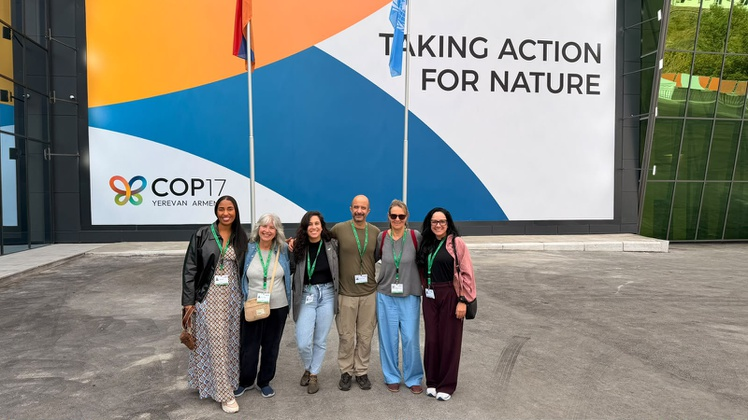
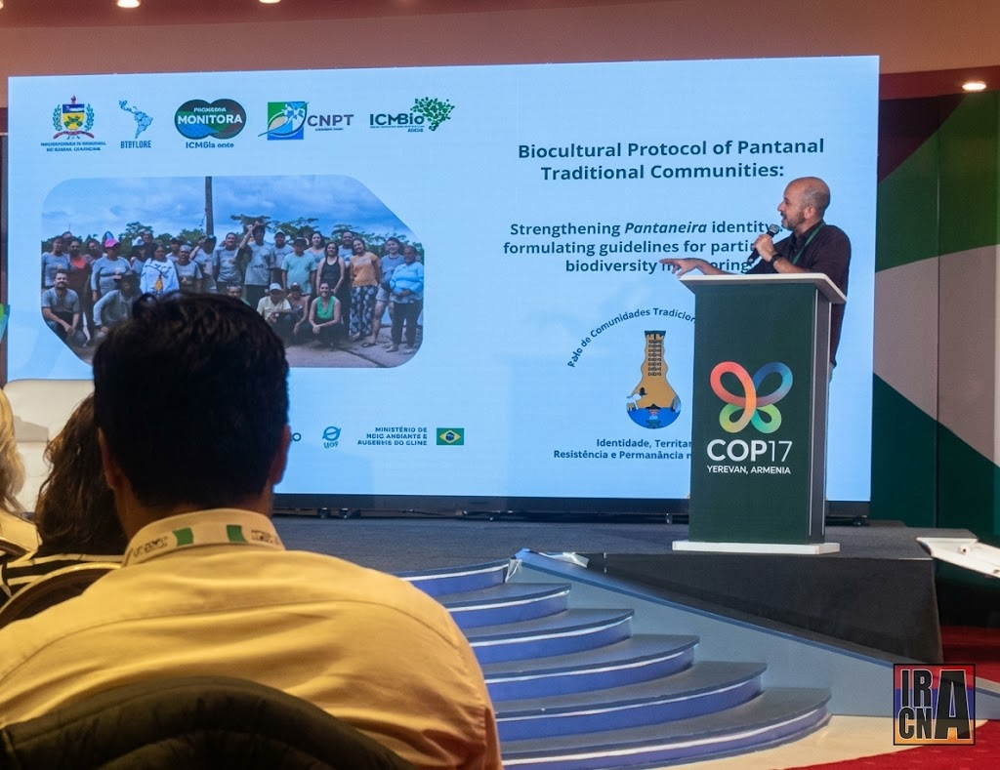
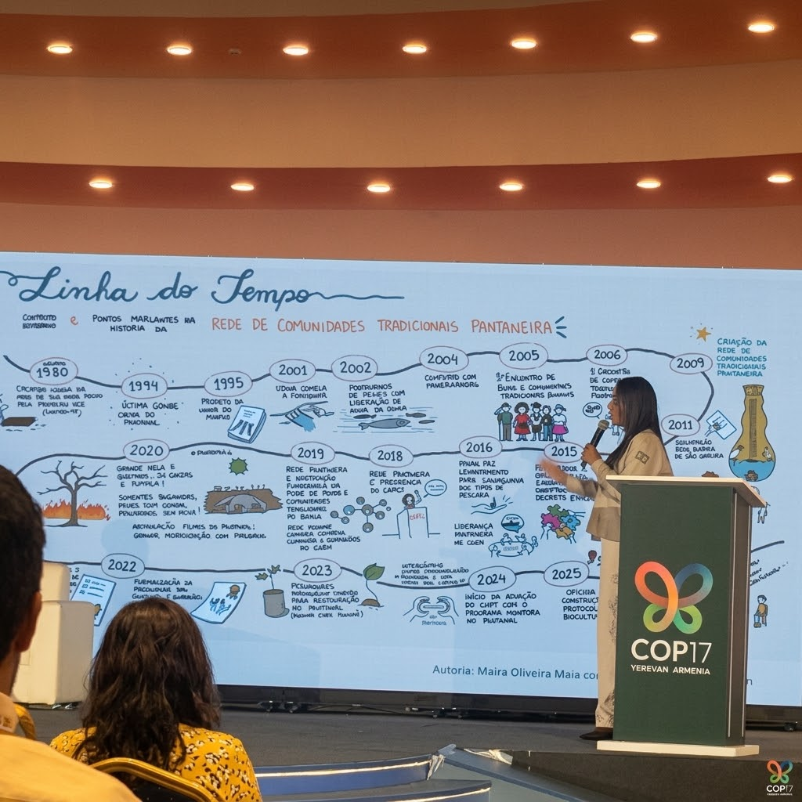
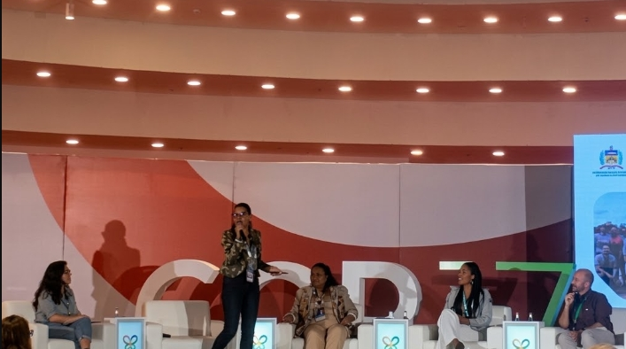
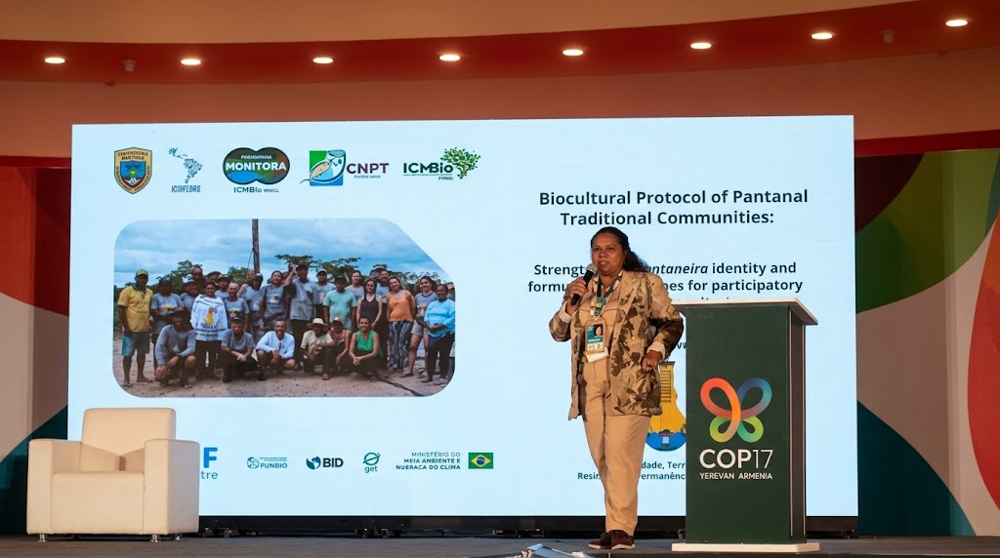
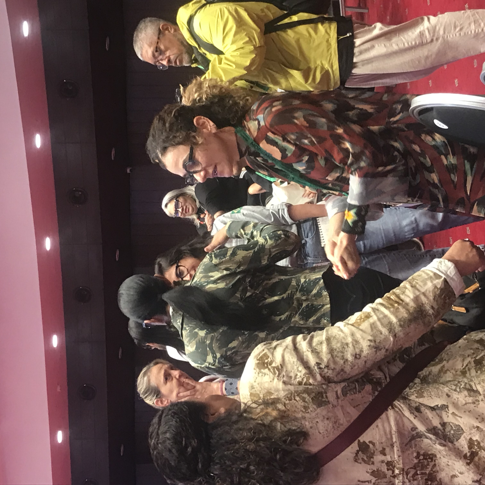

# **How Brazil’s Biocultural Protocols Reframe Community Monitoring at COP17**

**By Mikael Yamiosei**

_Published via IRCNA (malhelel.github.io/articles/)_

**Location:** Upper Stage, Green Zone, Karen Demirchyan Sports and Concerts Complex — Yerevan, Armenia

**Event Date:** October 22, 2026

### **Introduction: Ground-Level Realities on the Upper Stage**

Walking up to the Upper Stage in the Green Zone of the Karen Demirchyan Sports and Concerts Complex on October 22, 2026, the contrast with the Blue Zone negotiations was immediate. While formal state delegations wrestled over dense diplomatic phrasing behind closed doors, the Green Zone hummed with a different kind of urgency—one driven by practitioners, researchers, and land defenders confronting the realities of implementation.

On this afternoon, the session hosted by Brazil’s Instituto Chico Mendes de Conservação da Biodiversidade (ICMBio), the Ministry of the Environment and Climate Change (MMA), and the Pantanal Traditional Communities Network (_Rede Pantaneira de Comunidades Tradicionais_) cut straight to the central friction of the United Nations Biodiversity Conference (CBD COP17): global conservation targets remain dead letters unless the states holding them are willing to devolve data sovereignty and legal authority to local knowledge holders.

Opening the panel, Pérola Pereira welcomed the room and anchored the session squarely within the architecture of the **Kunming-Montreal Global Biodiversity Framework (KMGBF)**. She emphasized that achieving **Target 21**—guaranteeing access to data, information, and knowledge while strictly safeguarding traditional knowledge under Free, Prior, and Informed Consent (FPIC)—and **Target 22**—ensuring the full, equitable, and gender-responsive participation of Indigenous peoples and local communities—requires dismantling top-down conservation models that treat local populations as threats rather than stewards.

### **Panel Roster and Institutional Representation**

To establish absolute journalistic precision, the presentation panel on stage comprised key institutional representatives and community leaders:

- **Pérola Pereira** — Representative and International Affairs Coordinator, Instituto Chico Mendes de Conservação da Biodiversidade (ICMBio).
- **Rodrigo Jorge** — Biodiversity Monitoring Coordinator (_Programa Monitora_), ICMBio.
- **Gabrielle Soeiro** — Coordinator, National Center for Traditional Peoples and Communities (CNPT/ICMBio).
- **Claudia Regina** — Director, Secretariat for Traditional Peoples and Communities, Ministry of the Environment and Climate Change (MMA); Representative, Pantanal Traditional Communities Network (_Rede Pantaneira_).
- **Cristiane Julião** — Indigenous Leader, Pankararu People; Representative, Articulação dos Povos Indígenas do Brasil (APIB).

### **Language as Sovereignty: The Act of Speaking Portuguese in Yerevan**

### 

The session's political weight was underscored immediately when Rodrigo Silva Pinto Jorge took the microphone. Rather than defaulting to English as the lingua franca of international diplomacy, Rodrigo delivered his address in Brazilian Portuguese, with Pérola Pereira translating key sections for the global audience.

In an international policy arena where specialized idioms often function as exclusionary gatekeeping, insisting on one’s mother tongue is an act of cultural resistance and linguistic sovereignty. Traditional ecological knowledge is inextricably bound to native vocabulary, local nomenclature, and community-specific concepts that are flattened or erased when forced through standard international legal prose. By opening in Portuguese, the Brazilian delegation established that defending biodiversity requires preserving the linguistic vehicles of the people who live within and defend the territory.

### **_Programa Monitora_: Operationalizing Community Science in Brazil**

Shifting from linguistic governance to institutional execution, Rodrigo Silva Pinto Jorge detailed the structure of Brazil’s **National Biodiversity Monitoring Program (_Programa Monitora_)**, coordinated by ICMBio. Operating across approximately 130 of Brazil's 352 federal Conservation Units (UCs), the program is built upon three foundational subprograms: _Terrestre_ (Terrestrial and Forest Systems), _Aquático Continental_ (Freshwater and Floodplains), and _Marinho_ (Marine Ecosystems).

A core argument of Rodrigo’s presentation targeted a persistent misconception in environmental administration: the assumption that commercially exploited species do not require biological monitoring or active ecological management. To dismantle this myth, he pointed to the landmark case study of the **Parque Nacional da Lagoa do Peixe** (_Parna da Lagoa do Peixe_).

Though designated as a strictly protected national park (_proteção integral_), traditional communities had harvested shrimp in the lagoon long before the federal unit was established. Rather than enforcing top-down bans that criminalize subsistence livelihoods, ICMBio and the fishers instituted a formal Commitment Term (_termo de compromisso_), embedding participatory shrimp monitoring into the park's management framework.

The mechanism relies entirely on empirical biometric data. By tracking the average size of harvested shrimp over time, the fishers generate hard scientific evidence. When the biometric tracking reveals a decline in average shrimp size, the community and park management jointly suspend the fishing season, allowing stocks to regenerate autonomously. This grassroots dataset did more than regulate local extraction; it provided the concrete, verifiable evidence required to officially revise IBAMA regulatory norms, proving that community-led monitoring strengthens state environmental law rather than undermining it.

### **Biocultural Protocols as Legal and Territorial Safeguards**

Following Rodrigo, Gabrielle Soeiro turned the discussion toward legal self-determination. Speaking on behalf of ICMBio’s National Center for Traditional Peoples and Communities (CNPT) at the explicit request of the Pantanal Traditional Communities Network, Louiziane Gabrielle introduced biocultural protocols not as abstract academic concepts, but as community-driven legal instruments.

Developed from the ground up through participatory workshops, online exchanges, and field validation visits, these protocols give traditional Pantanal communities (_Comunidades Tradicionais Pantaneiras_) the institutional tools required to defend their territorial rights and self-determination. Louiziane Gabrielle outlined the core pillars of the Pantanal protocol: guaranteeing the preservation and visibility of the traditional Pantanal way of life, and securing structural visibility, equity, and rights for Pantanarian women (_Mulheres Pantaneiras_).

Her warning to the international audience was unequivocal: protected territories must never be reduced to mere geographical percentages set aside to satisfy global biodiversity metrics. They are living human spaces, where environmental protection is inseparable from land rights, human dignity, and local governance.

### **Indigenous Leadership and Historical Precedence**

Cristiane Julião, an Indigenous leader of the Pankararu people, brought the panel’s focus to Indigenous territorial governance and historical precedence. Addressing the room, she emphasized that external actors, researchers, and state officials must fundamentally reevaluate how they approach Indigenous territorial spaces. Indigenous communities lived on, cared for, and managed these lands long before modern state borders or conservation decrees existed. Respecting these communities requires honoring their autonomous traditions, internal governance structures, and historical precedence on the land.

Claudia Regina, serving as Director at the Ministry of the Environment and Climate Change (MMA) while representing Pantanal traditional communities, reinforced this bridge between grassroots community organization and federal administration, demonstrating how state policy must directly mirror the demands of traditional knowledge holders.

### **From the Amazon and Pantanal to the South Caucasus: Parallels at COP17**

Sitting in the audience in Yerevan, the structural parallels between Brazil’s environmental challenges and those of host nation Armenia were striking. While Brazil manages vast tropical floodplains, forests, and marine expanses, Armenia protects fragile mountain ecosystems, high-altitude alpine meadows, and critical freshwater basins—most notably the Lake Sevan catchment and its surrounding watershed systems.

Despite the geographic divergence, the governance hurdles are identical. In Armenia’s rural and high-altitude regions, local farmers, pastoralists, and community gatherers possess generations of micro-climatic and seasonal data regarding local flora, grazing lands, and water sources. Just as top-down conservation models in Brazil historically overlooked the knowledge of Pantanarian fishers, formal ecological assessments in the South Caucasus frequently miss vital environmental shifts by ignoring the observations of people living directly on the land.

As Armenia updates its National Biodiversity Strategy and Action Plan in alignment with the Kunming-Montreal framework, the Brazilian model presented on the Upper Stage offers a clear, actionable template. When state institutions grant legal standing to community monitoring—turning informal local knowledge into formalized instruments like the _termo de compromisso_—conservation ceases to be an exercise in policing local populations and becomes a collaborative defense of shared ecosystems.

### **Conclusion: Reimagining Global Biodiversity Governance**

The side event in the Green Zone exposed the central tension of COP17: global agreements will remain aspirational rhetoric unless national governments are willing to devolve authority, respect linguistic and data sovereignty, and hand the tools of measurement back to the communities who have guarded the earth's remaining biodiversity all along. ICMBio’s presentation proved that when states partner with traditional networks through biocultural protocols and participatory monitoring, conservation achieves both genuine equity and uncompromised ecological rigor.

### **Sources & Primary Documentation**

1. **On-the-Ground Video Footage & Primary Field Notes:**
    - Primary Field Video Recording — Part 1: _On-the-ground video footage of the ICMBio COP17 side event_, recorded live by Mikael Yamiosei at the Green Zone Upper Stage, Karen Demirchyan Complex, Yerevan, Armenia (October 22, 2026).

- Primary Field Photographing — Part 2: _On-the-ground photos captured of the ICMBio COP17 side event_, taken live by Mikael Yamiosei at the Green Zone Upper Stage, Karen Demirchyan Complex, Yerevan, Armenia (October 22, 2026).
- Cover image by disclosure/ ICMBio

2. **International Treaties & Frameworks:**
    - Convention on Biological Diversity (CBD) — _Kunming-Montreal Global Biodiversity Framework (KMGBF)_, specifically Target 21 (Data & Knowledge Accessibility) and Target 22 (Inclusive Participation & Gender Equity).

- Convention on Biological Diversity (CBD) — _Article 8(j)_ (Traditional Knowledge, Innovations, and Practices) & _Nagoya Protocol on Access and Benefit-Sharing_.

3. **Institutional Documents & Government Frameworks (Brazil):**

- Instituto Chico Mendes de Conservação da Biodiversidade (ICMBio) — _Programa Nacional de Monitoramento da Biodiversidade (Programa Monitora)_.
- ICMBio / CNPT — _Centro Nacional de Pesquisa e Conservação da Sociobiodiversidade Associada Povos e Comunidades Tradicionais_.
- Case Study Documentation: _Parque Nacional da Lagoa do Peixe_ (Fishery management Commitment Term / _Termo de Compromisso_ & IBAMA normative updates).

4. **Conference & Host Country Context:**

- Official CBD COP17 Program, Green Zone Upper Stage, Karen Demirchyan Sports and Concerts Complex, Yerevan, Armenia (Session Date: October 22, 2026).
- Ministry of Environment of the Republic of Armenia — _National Biodiversity Strategy and Action Plan (NBSAP)_ alignment and regional framework discussions.
